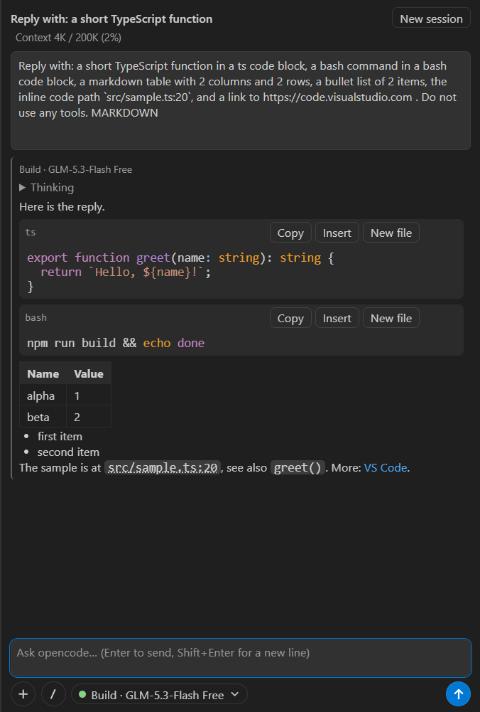
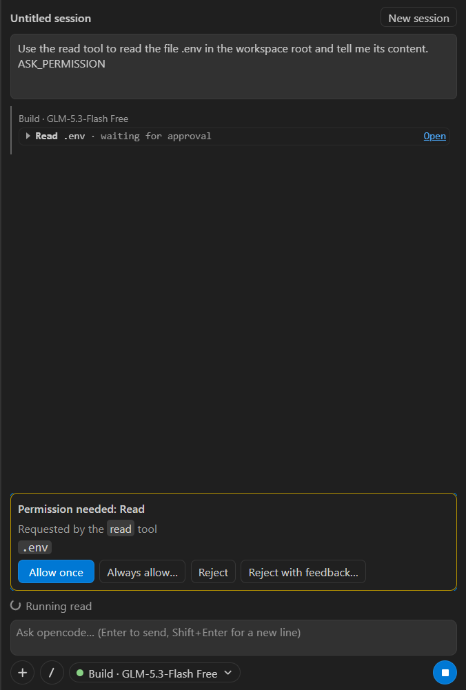

# OpenCode Station

[English](https://github.com/sergwei/open-vs-code/blob/main/README.md) | **Español**

Interfaz gráfica no oficial para opencode en Visual Studio Code.

Una interfaz de chat cómoda con el ratón para [opencode](https://github.com/anomalyco/opencode),
dentro de VS Code, al estilo de la extensión de Claude Code, para no depender de las limitaciones de
la terminal (muchas terminales de Linux y macOS no admiten el ratón). La extensión es un **cliente
de `opencode serve`**, no un envoltorio de la interfaz de terminal: arranca el servidor para tu
espacio de trabajo y habla con él por HTTP. No está afiliada a opencode ni a Microsoft.

> **Solo se admite opencode v2** (versión mayor 2, probada con 2.2.7). La línea 1.x (`opencode-ai`)
> no funciona con esta extensión.

## Requisitos

- VS Code 1.105 o posterior.
- opencode **v2** instalado en la máquina donde se ejecuta VS Code:
  - npm: `npm i -g @opencode/cli`. Con npm 11 el script de instalación se bloquea y no se crea el
    binario; usa en su lugar `npm i -g --allow-scripts=@opencode/cli @opencode/cli`.
  - Homebrew: `brew install anomalyco/tap/opencode-v2`.
- Un proveedor y un modelo configurados en opencode. ¿Aún no hay ninguno? Abre la pestaña
  **Configuración de OpenCode**, ve a **Proveedores**, pulsa **+ Agregar proveedor** y elige uno
  (clave de API o inicio de sesión).

## Instalación

Busca **OpenCode Station** en la vista de Extensiones de VS Code, o instálala desde el
[Visual Studio Marketplace](https://marketplace.visualstudio.com/items?itemName=sergwei.open-vs-code).
Los editores que usan [Open VSX](https://open-vsx.org/extension/sergwei/open-vs-code) (VSCodium,
Cursor y otros) la encuentran allí con el mismo nombre. Para compilar el `.vsix` desde el código
fuente (Node 24 y git), consulta
[Building the .vsix](https://github.com/sergwei/open-vs-code/blob/main/docs/features.md#building-the-vsix-from-source)
(en inglés).

## Inicio rápido

1. Abre una carpeta y pulsa el icono **OpenCode** de la barra de actividad. La extensión arranca
   `opencode serve` para la carpeta (en `127.0.0.1`, con puerto y contraseña aleatorios) y lo para
   al cerrar la ventana.
2. Pulsa **Nueva sesión** en la vista **Sesiones** para abrir una pestaña de chat junto a tu código.
   Escribe y pulsa Intro; Escape o **Detener** interrumpe un turno. `Ctrl+Alt+P` (`Cmd+Alt+P` en
   macOS) salta al prompt y vuelve al editor.
3. Para preguntar sobre código sin abrir el chat, selecciónalo, haz clic derecho y elige **Explicar
   con OpenCode** o **Corregir con OpenCode** (o **Agregar al chat de OpenCode**). En el Explorador,
   haz clic derecho sobre archivos para explicarlos o adjuntarlos.

## Qué incluye

Cada punto está descrito en
[Features and usage in detail](https://github.com/sergwei/open-vs-code/blob/main/docs/features.md)
(en inglés).

- **Chat** con Markdown en streaming, resaltado de sintaxis, acciones sobre el código, tarjetas de
  herramientas plegables con diffs y una línea de contexto y coste (con **Compactar** a partir del
  80 % de la ventana).
- **Pestañas de chat o barra lateral** (`openVsCode.chatLocation`): por defecto una pestaña de
  editor por sesión, o un único chat en la barra lateral. Las pestañas vuelven tras recargar la
  ventana.
- Árbol de **Sesiones**: agrupado por fecha, búsqueda, renombrar, eliminar, bifurcar desde
  cualquier mensaje, carpetas, anclados, archivados, filtros y una sección "Requiere atención". Las
  sesiones de subagentes se abren desde su sesión padre.
- Caja **Inicio rápido** en lo alto de la vista: abre una pestaña de chat nueva con el modelo que
  elijas, muestra qué se está ejecutando o espera tu respuesta, y el estado del servidor y de los
  servidores MCP. Bajo el árbol, **Cambios de las sesiones** (clic para el diff de VS Code) y **Uso
  (todos los proyectos)** (coste y tokens, hoy y 7 días).
- **Permisos y preguntas** como tarjetas que respondes con un clic, con notificación e insignia
  cuando el chat está oculto. Varias peticiones comparten una caja con una pestaña cada una.
- **Modo de trabajo** (Manual / Auto) por sesión: Auto responde "permitir una vez" por ti, salvo
  secretos, salir del proyecto, borrar, publicar o comandos destructivos (es una heurística, no una
  garantía).
- **Chip de agente y modelo**, variantes de razonamiento, comandos `/` (los de opencode, los de tu
  proyecto y los de MCP), menciones `@` y un menú "+" para adjuntar la selección, archivos e
  imágenes.
- **Adjuntar y soltar:** clic derecho en el Explorador, arrastrar con Mayús (chat de la barra
  lateral) o pegar imágenes (PNG, JPEG, GIF, WebP, hasta 10 MiB).
- **Escribe mientras el agente trabaja:** Intro encola un mensaje y `Ctrl+Intro` (`Cmd+Intro`)
  dirige el turno. Un **monitor de subagentes** los lista con Abrir, Responder y Detener.
- **Pestaña Sesión:** instrucciones fijadas, medidor de contexto, totales, subagentes y
  **Exportar** (Markdown o JSON).
- **Archivos modificados y reversión:** la pestaña **Cambios** abre el diff de VS Code; "Revertir
  desde aquí" deshace un turno, archivos incluidos, y se puede restaurar.
- Pestaña **Configuración de OpenCode**: proveedores (clave de API, OAuth), servidores MCP, mods,
  modo de trabajo y opciones avanzadas. Los **mods** son JavaScript tuyo, cargado solo desde tu
  carpeta de usuario; consulta
  [mods](https://github.com/sergwei/open-vs-code/blob/main/docs/mods.md) (en inglés).
- Temas claro, oscuro y de alto contraste, navegación con teclado y etiquetas para lectores de
  pantalla. La interfaz está en inglés y español y sigue el idioma de VS Code (el español requiere
  el
  [Spanish Language Pack](https://marketplace.visualstudio.com/items?itemName=MS-CEINTL.vscode-language-pack-es)).
  Un elemento de la barra de estado muestra el estado del servidor.

## Configuración

Busca "OpenCode" en Configuración. Los que más se cambian:

| Opción | Por defecto | Qué hace |
| --- | --- | --- |
| `openVsCode.chatLocation` | `editor` | `editor`: una pestaña de chat por sesión. `sidebar`: un chat en la barra lateral. |
| `openVsCode.defaultModel` | vacío | Modelo de las sesiones nuevas, como `provider/model`. |
| `openVsCode.opencodePath` | vacío | Ruta al ejecutable de opencode v2, si no está en el `PATH`. |
| `openVsCode.serverUrl` | vacío | Usa un servidor opencode v2 que ya se ejecuta en esta máquina. |
| `openVsCode.autoStart` | `true` | Arranca el servidor al iniciar la ventana. |

`openVsCode.mods.enabled`, la lista completa, todos los comandos y los atajos de teclado están en
[Settings, commands and shortcuts](https://github.com/sergwei/open-vs-code/blob/main/docs/commands.md)
(en inglés).

## Limitaciones principales

- Solo opencode v2, y solo un servidor en la máquina local.
- Las carpetas, los anclados y los archivados del árbol Sesiones viven en el almacenamiento del
  espacio de trabajo de VS Code, no en opencode: mover, renombrar o volver a clonar la carpeta del
  proyecto los pierde.
- Se informa de que arrastrar archivos desde el Explorador al chat no funciona en VS Code 1.140 o
  posterior; **Agregar al chat de OpenCode**, Adjuntar y las menciones `@` funcionan siempre.
- Los atajos por defecto usan Ctrl+Alt, que en Windows es AltGr: reasígnalos si tu distribución de
  teclado lo requiere.
- Probada sobre todo en Windows; la integración continua compila y prueba en Windows, macOS y Linux.

La lista completa está en
[Known limitations](https://github.com/sergwei/open-vs-code/blob/main/docs/limitations.md) (en
inglés).

## Privacidad y seguridad

No se admiten espacios de trabajo no confiables, porque opencode puede ejecutar lo que define el
proyecto. opencode ejecuta los plugins que trae un proyecto, así que la extensión pregunta antes de
arrancar opencode en una carpeta que los tenga. La vista del chat nunca habla con el servidor; el
puerto y las contraseñas se quedan en el extension host (las contraseñas, en SecretStorage), y no se
envía nada a ningún sitio salvo al servidor opencode que uses. Detalles:
[Privacy and security](https://github.com/sergwei/open-vs-code/blob/main/docs/privacy.md) (en
inglés).

## Licencia

[PolyForm Shield License 1.0.0](https://github.com/sergwei/open-vs-code/blob/main/LICENSE). Puedes
usar, modificar y compartir esta extensión para cualquier fin, también en el trabajo, salvo
ofrecer un producto que compita con ella (o con un producto que su autor ofrezca usándola):
publicar una copia o un fork renombrado como alternativa a esta extensión no está permitido, ni
siquiera gratis, y eso sigue así aunque el autor deje de ofrecerla. Quien reciba una copia tuya
debe recibir también los términos de la licencia (o su URL) y su línea `Required Notice:`. Esto la
hace de código disponible (source-available), no de código abierto tal como lo define la OSI. Las
confirmaciones (commits) anteriores a la adopción de esta licencia se publicaron bajo la licencia
MIT.

opencode es un proyecto independiente de [anomalyco](https://github.com/anomalyco/opencode), con su
propia licencia.
