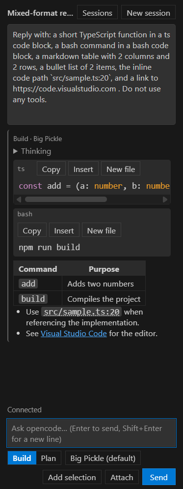
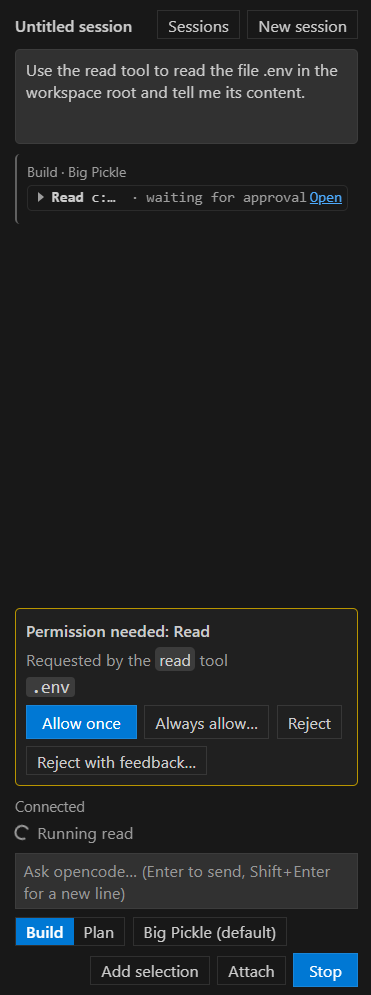
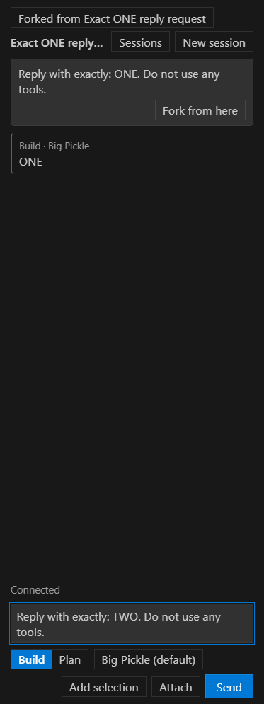
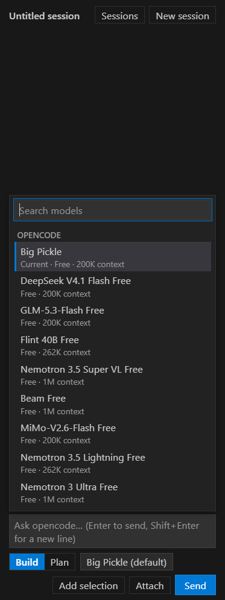

# OpenCode GUI

A mouse-friendly chat interface for [opencode](https://github.com/anomalyco/opencode), inside
VS Code. It gives opencode the kind of graphical interface the Claude Code extension has, so you
do not depend on the limits of a terminal (many terminals on Linux and macOS do not support the
mouse).

The extension is a **client of `opencode serve`**, not a wrapper around the terminal UI: it starts
the server for your workspace and talks to it over HTTP. This is an unofficial project: it is not
affiliated with opencode or with Microsoft.

> **Only opencode v2 is supported** (major version 2, tested with 2.0.32). The 1.x line
> (`opencode-ai`) does not work with this extension.

## Features

- **Streaming chat** with Markdown, syntax highlighting and code actions: copy, insert at the
  cursor, open in a new file, and open `path:line` references in the editor.

  

- **Permission and question cards.** When opencode asks, you answer with a click. With the chat
  hidden, or (with chat tabs) when the request belongs to a tab that is not in front, you get a
  notification and a badge on the Activity Bar icon.

  

- **Sessions:** a list with groups and search, rename, delete, fork from any of your messages and
  jump into subagent sessions. The open session is remembered per workspace.

  

- **Server status in the status bar.** An `OpenCode` item shows whether the server is starting,
  running (with the model a new session will use), not started or unavailable; click it to open the
  chat.

- **The chat in editor tabs or in the side bar.** By default (`openVsCode.chatLocation` is
  `editor`) every session opens in its own editor tab, beside your code, and the OpenCode view is a
  native **Sessions** tree; set it to `sidebar` to keep one chat in the side bar instead. The tree
  lists the sessions of the folder grouped by Today, Yesterday, Previous 7 days
  and Older, each row with its state shown by an icon (Running, Needs input, Failed) and, when the
  side bar has room, in words (also Fork, Tab) before the time, with Rename and Delete on the row, a **Search Sessions…** button that searches the titles on the
  server, and a **Show more sessions** row. Clicking a session opens it in a tab, or brings that tab
  to the front if it already has one, instead of opening another. Changing the setting takes effect at once: the session
  of the side bar opens in a tab, and going back leaves the tabs open. After **Developer: Reload
  Window** the tabs come back, each with its session, its draft and its
  title.

- **One chip for agent and model:** the prompt bar shows "agent · model" (with the reasoning level
  and a connection dot); it opens a panel where you choose the agent (Build, Plan…), the model and,
  when the model offers them, a reasoning variant.

  

- **Slash commands (issue #33):** type `/` at the start of the prompt, or press the **/** button
  next to the "+", to list opencode's commands (the built-in `init` and `review`, the ones in your
  project's `.opencode/command` folder and the ones from MCP servers). Choosing one writes
  `/name` and a space into the box so you can add arguments; Enter runs it. A `/word` that is not on the list
  is sent as a normal prompt. The conversation shows the expanded text of the command, as opencode
  stores it, not what you typed.
- **Editor and Explorer context menus (issue #36):** right-click in a text editor for **Add to
  OpenCode Chat** (attaches the selection, or the whole file when nothing is selected),
  **Explain with OpenCode** and **Fix with OpenCode**. Explain and Fix send a ready-made prompt at
  once (`Explain what @src/a.ts#2-3 does.`, `Fix the problems in @src/a.ts#2-3.`) with the
  selection attached; Fix also lists the errors and warnings VS Code reports for that range (up to
  20). In the Explorer, **Explain with OpenCode** works on one or several files. If the chat cannot
  send right then (a turn is running, or the server is not connected yet; with `autoStart` off and
  the server not started, the prompt is sent and starts it), the prompt is left in
  the prompt box with a notice, and your own draft is never overwritten. The entries only appear
  on files that exist on disk. From the Explorer, folders and files outside the workspace folder
  are counted in a notice inside the chat ("1 selected item was not added…"); from the editor
  and the Command Palette, a refused file (outside the workspace folder) shows a native VS Code
  warning. A prompt that waited too long for the chat to be shown (over 10 seconds) is left in
  the prompt box, with a notice, instead of being sent.
- **Collapsible tool cards** for shell, read, grep and edit calls, with diffs for edits.
- **`@` mentions** to add files to the prompt, and a "+" menu in the prompt bar with **Add
  selection** (attaches the editor selection), **Attach file…**, **Attach image…** and **Mention a
  file**.
- **Drop files and paste images (issue #30):** right-click files in the Explorer and choose
  **Add to OpenCode Chat** (works in every VS Code version), or drag them from the Explorer onto the
  prompt box **while holding Shift** (VS Code only delivers a drop to a side-bar view with Shift
  held: that is the side-bar chat, `chatLocation` set to `sidebar`; the editor tabs of the default
  location are not checked for this). Only regular files inside the workspace folder are
  added, and a dropped file must also be one that opencode lists (what git ignores, `.env`
  included, cannot be dropped: use "Attach file…" in the "+" menu for that); folders and anything else are skipped with
  one notice that counts them. Paste an image (PNG, JPEG, GIF or WebP, up to 10 MiB) with
  Ctrl/Cmd+V to attach it, with a thumbnail on its chip; an image dropped from your system's file
  manager is attached the same way, and any other file dropped from there is refused with a notice
  (drop it from the VS Code Explorer, or use "Attach file…"). If the selected model cannot read images,
  the chat says so and opencode tells the model. **Retry, "Fork from here" and "Revert from here"
  re-attach files but not pasted images**: paste them again.
- **Context and cost:** a line under the session title shows how much of the model's context the
  last step used and, when the model is not free, what the session cost so far, direct subagents
  included.
- **Changed files:** a "Changed files (N)" list under the header shows what the agent changed in
  the session (git repositories only); a click opens VS Code's own diff editor with the original on
  the left and the file on the right.
- **Revert from a message:** "Revert from here" on one of your messages undoes that turn and
  everything after it, files included, and hides those messages. A block under the conversation
  lists the files it restored, "Restore" brings everything back and "Discard for good" deletes the
  hidden messages. Sending a new message also makes the revert final. The revert also replaces
  edits you made by hand to those files after the reverted turns touched them: "Restore" brings them back
  (but drops what you edited while reverted), and once the revert is final they are gone.
- **Themes and accessibility:** light, dark and high-contrast, keyboard navigation and screen
  reader labels. Colors come from your VS Code theme.

## Requirements

- VS Code 1.105 or later.
- opencode **v2** installed on the machine where VS Code runs:
  - npm: `npm i -g @opencode/cli`. With npm 11 the install script is blocked and the binary is not
    created; use `npm i -g --allow-scripts=@opencode/cli @opencode/cli` instead.
  - Homebrew: `brew install anomalyco/tap/opencode-v2`.
- A provider and model configured in opencode.

## Installation

The extension is not on the Marketplace yet; issue #43 will publish it there. Until then, build the
`.vsix` from the source code (Node 24 and git are needed):

1. Clone the repository: `git clone https://github.com/sergwei/open-vs-code.git`
2. In the cloned folder, install the dependencies: `npm ci`
3. Build the package: `npm run vsix`. It writes `open-vs-code-<version>.vsix` in that folder.
4. In VS Code, run **Extensions: Install from VSIX...** from the Command Palette and pick that
   file (or `code --install-extension open-vs-code-<version>.vsix`).

## Usage

1. Open a folder in VS Code and click the **OpenCode** icon in the Activity Bar: the **Sessions**
   view lists the sessions of the folder. Press **New Session** in its title bar to open a chat tab
   beside your code.
2. The extension starts `opencode serve` for the workspace folder, on `127.0.0.1` with a random port
   and a random password, and stops it when the window closes.
3. Type a prompt in the tab and press Enter. Press Escape or **Stop** to interrupt a turn. From the editor,
   press Ctrl+Alt+P (Cmd+Alt+P on macOS) to jump to the prompt; press it again to come back to the
   editor (see [Keyboard shortcuts](#keyboard-shortcuts)).

To ask about code without opening the chat first, select it in the editor, right-click and choose
**Explain with OpenCode** or **Fix with OpenCode**; to send whole files, right-click them in the
Explorer and choose **Explain with OpenCode**. The chat opens by itself and the prompt is sent in
the open session.

The chat lives in editor tabs by default (`openVsCode.chatLocation` is `editor`). The OpenCode view
lists the sessions of the folder: click one (or press Enter on it) to open it, `F2` renames the
selected one and `Delete` deletes it. **New Session** opens a new tab, **Open Chat** brings the most
recent tab to the front (or opens the last session of the folder when there is none). The chat in a
tab has no Sessions button: the tree is the one place to browse sessions. Insert at cursor and Add
selection write into the last text editor you used, and file links and diffs open outside the
chat's group.

To keep one chat in the side bar instead, set `openVsCode.chatLocation` to `sidebar` (Settings:
Chat Location); the OpenCode view then is the **Chat** view, and the tabs you had open stay open.

In a multi-root workspace, choose the folder opencode works in with **OpenCode: Select Workspace
Folder**.

## Settings

| Setting | Scope | Default | What it does |
| --- | --- | --- | --- |
| `openVsCode.opencodePath` | machine | empty | Absolute path to the opencode **v2** executable. Empty searches `PATH` for `opencode2`, then `opencode`. On Windows an npm `opencode.cmd` shim is accepted. Not used while `openVsCode.serverUrl` is set. |
| `openVsCode.serverUrl` | machine | empty | Address of an opencode **v2** server that is already running on **this machine**, for example `http://127.0.0.1:4096`. Empty lets the extension launch its own server. The extension then does not use `openVsCode.opencodePath`. See [Using a server you started](#using-a-server-you-started). |
| `openVsCode.defaultModel` | window | empty | Model every **new** chat session starts with, written `provider/model` (for example `opencode/big-pickle`). It wins over the last model you used. A badly written or unavailable value is ignored with a warning. |
| `openVsCode.autoStart` | window | `true` | Launch the opencode server when the window starts. Turn it off and the chat shows **not started**; **OpenCode: Restart Server**, the Start button or your first prompt starts it. No effect while `openVsCode.serverUrl` is set. |
| `openVsCode.chatLocation` | window | `editor` | Where the chat lives: `editor` (one editor tab per session, and the OpenCode view lists the sessions) or `sidebar` (one chat in the OpenCode view). Any other value counts as `editor`. |

## Commands

All commands are in the Command Palette under the **OpenCode** category, except the ones without a
category below, which live in the right-click menus. The three editor entries are also in the
Command Palette (they act on the active editor); the two Explorer entries are not.

| Command | What it does |
| --- | --- |
| **OpenCode: Show Logs** | Opens the OpenCode output channel. |
| **OpenCode: Restart Server** | Restarts the server the extension launched (it also starts it when `openVsCode.autoStart` is off), or reconnects to the server in `openVsCode.serverUrl` when that setting is set. Also a button in the title bar of the Chat view (`chatLocation` set to `sidebar`) and an entry in the `...` menu of the Sessions view. |
| **OpenCode: Select Workspace Folder** | Chooses which folder the server runs in (multi-root workspaces only). |
| **OpenCode: Manage Saved Permissions** | Lists the permissions you chose to always allow and lets you revoke them. |
| **OpenCode: Set Server Password** | Stores the password of the server in `openVsCode.serverUrl` in VS Code's SecretStorage. |
| **OpenCode: Forget Server Password** | Deletes that stored password. |
| **OpenCode: Open Chat** | Shows the chat and puts the caret in the prompt. |
| **OpenCode: Focus Prompt** | Puts the caret in the prompt; pressed again while the chat has the focus, it returns to the editor. |
| **OpenCode: New Session** | Opens a new empty chat tab (the default, `chatLocation` set to `editor`). With `chatLocation` set to `sidebar` it is the same as the **New session** button: the next prompt starts a new session and your draft is kept. |
| **OpenCode: Open Settings** | Opens Settings filtered to this extension. |
| **OpenCode: Stop Response** | Same as **Stop**: interrupts the running turn. Run from the editor it also shows the chat; with no turn running it only says "No response is running". |
| **OpenCode: Rename Session…** | Row of the Sessions list (shown while `chatLocation` is not `sidebar`; the default is `editor`): asks for a new title. Also the pencil on the row and `F2`; not in the Command Palette. |
| **OpenCode: Delete Session** | Row of the Sessions list: after a confirmation, deletes the session for every opencode client and closes its tab. Also the bin on the row and `Delete`; not in the Command Palette. |
| **OpenCode: Search Sessions…** | Searches the session titles on the server and opens the one you pick. Only offered while `chatLocation` is not `sidebar` (the default is `editor`). Also a button in the Sessions title bar. |
| **Add to OpenCode Chat** | Explorer right-click menu: attaches the selected files to the prompt. |
| **Add to OpenCode Chat** | Editor right-click menu: attaches the selection (the whole file when nothing is selected). |
| **Explain with OpenCode** | Editor right-click menu: sends "Explain what @file#lines does." with the selection (or the file) attached. |
| **Explain with OpenCode** | Explorer right-click menu: sends "Explain what @a and @b do." with the selected files attached. |
| **Fix with OpenCode** | Editor right-click menu: sends "Fix the problems in @file#lines." with the selection attached and the errors and warnings VS Code reports there (up to 20). |

## Keyboard shortcuts

Four commands have a default shortcut. Change them in **File > Preferences > Keyboard Shortcuts**
(search for "OpenCode"); the other commands have none by default and you can bind them there too.

| Windows / Linux | macOS | Command | Works when |
| --- | --- | --- | --- |
| `Ctrl+Alt+P` | `Cmd+Alt+P` | OpenCode: Focus Prompt | the editor or the chat has the focus |
| `Ctrl+Alt+N` | `Cmd+Alt+N` | OpenCode: New Session | the chat has the focus |
| `F2` | `F2` | OpenCode: Rename Session… | the Sessions list has the focus |
| `Delete` | `Cmd+Backspace` | OpenCode: Delete Session | the Sessions list has the focus |

On Windows, Ctrl+Alt is the same as AltGr: if your keyboard layout types a character with AltGr+P
or AltGr+N, rebind the shortcut in Keyboard Shortcuts or it will run the command instead of typing.

## Using a server you started

Set `openVsCode.serverUrl` to a server that is already running on the same machine
(`127.0.0.1`, `[::1]` or `localhost`, over `http` or `https`). The extension then does not launch
its own. If the server has a password, run **OpenCode: Set Server Password**; the user name is
always `opencode`.

## Known limitations

- Only opencode v2; only a server on the local machine.
- VS Code may not see the PATH of a shell that uses a Node version manager such as fnm or nvm,
  depending on how VS Code is launched (for example, not from that shell). If the extension cannot
  find opencode, set `openVsCode.opencodePath` to the executable
  (`opencode.exe` on Windows).
- "Allowed once" lines in the history do not survive **Developer: Reload Window**: opencode keeps no
  trace of a permission that was allowed once.
- Dragging files from the Explorer onto the chat is reported not to work in VS Code 1.140 or later:
  the drop does not reach extension views, with or without Shift
  ([microsoft/vscode#339036](https://github.com/microsoft/vscode/issues/339036), open; this
  project has not been able to reproduce a real drag in its own tests). It is reported to work up
  to 1.139. **Add to OpenCode Chat**, Attach and `@` mentions work in every version.
- The default shortcuts use Ctrl+Alt (Cmd+Alt on macOS), which is AltGr on Windows; see
  [Keyboard shortcuts](#keyboard-shortcuts) to rebind them. They are checked against the default
  shortcuts of VS Code, not against those of your desktop environment or other extensions.
- The editor and Explorer context menus were only tried on Windows. On macOS and Linux (and on
  macOS with `window.titleBarStyle` set to `native`) VS Code may draw the menus natively; they
  should work the same, but this project has not run them there.
- The editor menu entries read the **saved** file: opencode reads the file from disk, so with
  unsaved changes the line numbers may not match what the model sees. Explain and Fix then do not
  send by themselves: they leave the prompt in the box with an "Unsaved changes" notice. Files that
  are not on disk (untitled, `git:` or output documents) have no entries.
- In `editor` mode every chat tab keeps its page in memory while it is hidden
  (`retainContextWhenHidden`), so each open tab costs memory; there is no cap on the number of tabs.
- Chat tabs are restored after **Developer: Reload Window**, but VS Code only brings back a tab
  when it is shown: the tabs in the background are restored when you open them, not before. A
  restored tab whose session is already open in another tab (or in the side bar view) closes itself
  and reveals the one that has it. One whose session was deleted comes back empty, with the notice
  "This session no longer exists", and keeps its draft. With `sidebar` the restored tabs stay open
  next to the view, as extra tabs.
- The Sessions tree lists the root sessions of the folder (50 at a time); subagent sessions are not
  rows, you reach them from the tab of their parent. **Needs input** marks a row for a request of
  its own session or of a subagent at any depth below it. The rows are emptied
  while the server is not running and come back on the next reconnection. The order only changes
  with the events that move a session's update time, so it can be stale until the next
  reconnection.
- Deleting a session deletes its subagent sessions too (opencode does it). A tab that was showing
  one of those subagent sessions gets the notice "deleted outside this view", although you deleted
  it yourself from the Sessions tree.
- While chat tabs are open, the extension starts when the window opens (VS Code needs it to restore
  them), so the opencode server starts even if you do not touch the chat.
- In `editor` mode a pending permission or question shows only in the tab of its session (and, for
  a subagent, in the tab of an ancestor session); the side bar chat still shows every one. You get
  the native notification, titled with the chat it comes from, when no chat tab that shows the
  request is the active editor, and **Open chat** reveals that tab (the tab of the root session for
  a subagent with no tab of its own). With two tabs side by side, a request from the one you are
  not in raises the notification and leaves your focus where it was; its card is not focused
  until you go to that tab (or press **Open chat**). With the side bar chat visible, a new request
  shows its card and the badge, but it neither moves the focus nor raises a notification. The chat
  tabs left over from `editor` mode keep showing only the requests of their own session and lineage
  in `sidebar` mode too, and **Open chat** looks in those tabs before the side bar chat.
- In `editor` mode, switching to another served folder (for example with **Select Workspace
  Folder**) while tabs are open leaves them empty, with the old title, until they are reloaded; only
  the first chat gets the session remembered for the new folder.
- The draft in the prompt box does not travel when `openVsCode.chatLocation` changes: the text and the
  attachments of the old surface stay with it.
- The editor tabs were only tried on Windows; the integration tests run on Windows, macOS and Linux,
  but the visual checks of the tabs do not.
- Mostly tested on Windows; CI builds and tests on Windows, macOS and Linux.

## Privacy and security

**Workspace Trust.** The extension does not support untrusted workspaces
(`capabilities.untrustedWorkspaces.supported: false`): while a folder is in Restricted Mode, VS Code
does not load it. The reason is that opencode can run what the project defines, with the
permissions of your user: a slash command in `.opencode/command` whose text contains `` !`cmd` ``
runs that shell command on your machine when you run the command. Trust the folder only if you
trust whoever wrote its `.opencode` files, its `opencode.json` and its `AGENTS.md`. (Checked by
`npm run test:visual`, step 25, on VS Code 1.144.0 and Windows 11 only.)

The chat view never talks to the opencode server. The port and the password live only in the
extension host, and the server password you set is kept in VS Code's SecretStorage. The extension
does not send any data anywhere other than to the opencode server you use.

## License

[MIT](LICENSE). opencode itself is a separate project by [anomalyco](https://github.com/anomalyco/opencode)
under its own license.
