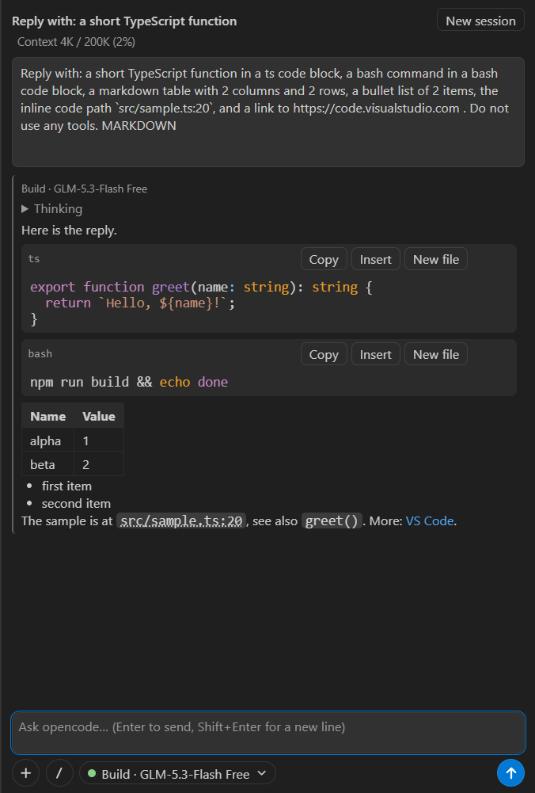
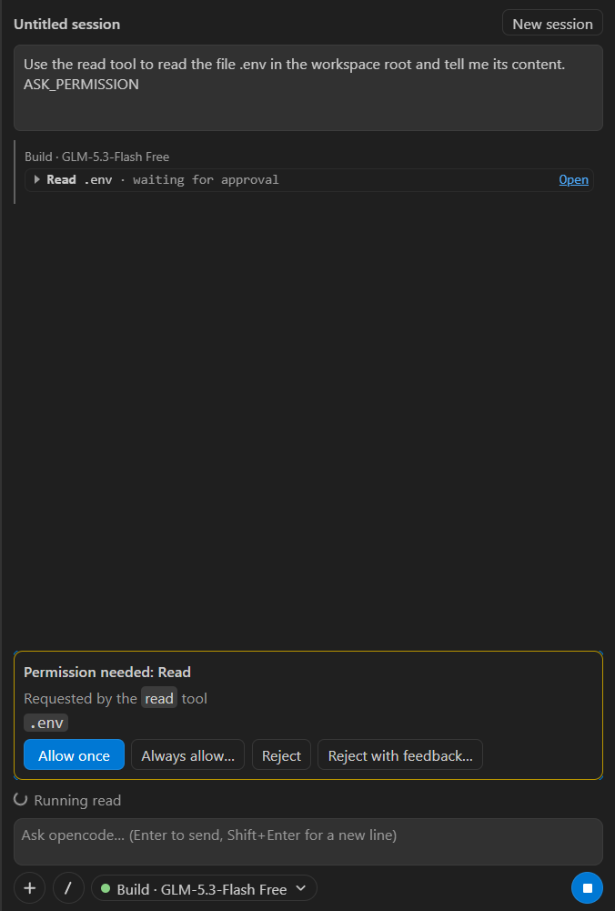

# OpenCode Station

**English** | [Español](https://github.com/sergwei/open-vs-code/blob/main/README.es.md)

Unofficial GUI for opencode in Visual Studio Code.

A mouse-friendly chat interface for [opencode](https://github.com/anomalyco/opencode), inside VS
Code, in the style of the Claude Code extension, so you do not depend on the limits of a terminal
(many terminals on Linux and macOS do not support the mouse). The extension is a **client of
`opencode serve`**, not a wrapper around the terminal UI: it starts the server for your workspace
and talks to it over HTTP. It is not affiliated with opencode or with Microsoft.

> **Only opencode v2 is supported** (major version 2, tested with 2.2.7). The 1.x line
> (`opencode-ai`) does not work with this extension.

## Requirements

- VS Code 1.105 or later.
- opencode **v2** installed on the machine where VS Code runs:
  - npm: `npm i -g @opencode/cli`. With npm 11 the install script is blocked and the binary is not
    created; use `npm i -g --allow-scripts=@opencode/cli @opencode/cli` instead.
  - Homebrew: `brew install anomalyco/tap/opencode-v2`.
- A provider and model configured in opencode. No provider yet? Open the **OpenCode Settings** tab,
  go to **Providers**, click **+ Add provider** and pick one (API key or sign-in).

## Installation

Search for **OpenCode Station** in the Extensions view of VS Code, or install it from the
[Visual Studio Marketplace](https://marketplace.visualstudio.com/items?itemName=sergwei.open-vs-code).
Editors that use [Open VSX](https://open-vsx.org/extension/sergwei/open-vs-code) (VSCodium, Cursor
and others) find it there under the same name. To build the `.vsix` from source instead (Node 24 and
git), see
[Building the .vsix](https://github.com/sergwei/open-vs-code/blob/main/docs/features.md#building-the-vsix-from-source).

## Quick start

1. Open a folder and click the **OpenCode** icon in the Activity Bar. The extension starts
   `opencode serve` for the folder (on `127.0.0.1`, random port and password) and stops it when the
   window closes.
2. Press **New Session** in the **Sessions** view to open a chat tab beside your code. Type and press
   Enter; Escape or **Stop** interrupts a turn. `Ctrl+Alt+P` (`Cmd+Alt+P` on macOS) jumps to the
   prompt and back to the editor.
3. To ask about code without opening the chat, select it, right-click and choose **Explain with
   OpenCode** or **Fix with OpenCode** (or **Add to OpenCode Chat**). In the Explorer, right-click
   files to explain or attach them.

## What you get

Each point is described in
[Features and usage in detail](https://github.com/sergwei/open-vs-code/blob/main/docs/features.md).

- **Chat** with streaming Markdown, syntax highlighting, code actions, collapsible tool cards with
  diffs, and a context and cost line (with **Compact** from 80 % of the window).
- **Chat tabs or side bar** (`openVsCode.chatLocation`): one editor tab per session by default, or a
  single chat in the side bar. Tabs come back after a window reload.
- **Sessions** tree: grouped by date, search, rename, delete, fork from any message, folders, pins,
  archive, filters and a "Needs attention" section. Subagent sessions open from their parent.
- **Quick start** box at the top of the view: open a new chat tab with the model you pick, see
  what is running or waiting for you, and check the status of the server and MCP servers. Under the
  tree, **Changes** of the sessions (click for VS Code's diff) and **Usage** (cost and tokens, today
  and 7 days, all projects).
- **Permissions and questions** as cards you answer with a click, with a notification and a badge
  when the chat is hidden. Several requests share one box with a tab each.
- **Work mode** (Manual / Auto) per session: Auto answers "allow once" for you, except for secrets,
  leaving the project, deleting, publishing or destructive commands (a heuristic, not a guarantee).
- **Agent and model chip**, reasoning variants, `/` slash commands (opencode's own, your project's
  and MCP's), `@` mentions and a "+" menu to attach the selection, files and images.
- **Attach and drop:** right-click in the Explorer, drag with Shift (side bar chat) or paste images
  (PNG, JPEG, GIF, WebP, up to 10 MiB).
- **Write while the agent works:** Enter queues a message, `Ctrl+Enter` (`Cmd+Enter`) steers the
  turn. A **subagent monitor** lists subagents with Open, Answer and Stop.
- **Session tab:** pinned instructions, context meter, totals, subagents and **Export** (Markdown or
  JSON).
- **Changed files and revert:** the **Changes** tab opens VS Code's diff; "Revert from here" undoes
  a turn, files included, and can be restored.
- **OpenCode Settings** tab: providers (API key, OAuth), MCP servers, mods, work mode and advanced
  options. **Mods** are your own JavaScript, loaded from your user folder only; see
  [mods](https://github.com/sergwei/open-vs-code/blob/main/docs/mods.md).
- Light, dark and high-contrast themes, keyboard navigation and screen reader labels. The UI is in
  English and Spanish and follows the display language of VS Code (Spanish needs the
  [Spanish Language Pack](https://marketplace.visualstudio.com/items?itemName=MS-CEINTL.vscode-language-pack-es)).
  A status bar item shows the state of the server.

## Settings

Search for "OpenCode" in Settings. The ones people change most:

| Setting | Default | What it does |
| --- | --- | --- |
| `openVsCode.chatLocation` | `editor` | `editor`: a chat tab per session. `sidebar`: one chat in the side bar. |
| `openVsCode.defaultModel` | empty | Model for new sessions, as `provider/model`. |
| `openVsCode.opencodePath` | empty | Path to the opencode v2 executable, if it is not on `PATH`. |
| `openVsCode.serverUrl` | empty | Use an opencode v2 server already running on this machine. |
| `openVsCode.autoStart` | `true` | Start the server when the window starts. |

`openVsCode.mods.enabled` and the full list, every command and the keyboard shortcuts are in
[Settings, commands and shortcuts](https://github.com/sergwei/open-vs-code/blob/main/docs/commands.md).

## Main limitations

- Only opencode v2, and only a server on the local machine.
- The folders, pins and archive of the Sessions tree live in VS Code's workspace storage, not in
  opencode: moving, renaming or re-cloning the project folder loses them.
- Dragging files from the Explorer onto the chat is reported not to work in VS Code 1.140 or later;
  **Add to OpenCode Chat**, Attach and `@` mentions always work.
- The default shortcuts use Ctrl+Alt, which is AltGr on Windows: rebind them if your layout needs it.
- Mostly tested on Windows; CI builds and tests on Windows, macOS and Linux.

The full list is in
[Known limitations](https://github.com/sergwei/open-vs-code/blob/main/docs/limitations.md).

## Privacy and security

Untrusted workspaces are not supported, because opencode can run what the project defines. opencode
runs the plugins a project brings, so the extension asks before it starts opencode in a folder that
has them. The chat view never talks to the server; the port and passwords stay in the extension host
(passwords in SecretStorage), and nothing is sent anywhere except to the opencode server you use.
Details:
[Privacy and security](https://github.com/sergwei/open-vs-code/blob/main/docs/privacy.md).

## License

[PolyForm Shield License 1.0.0](LICENSE). You may use, change and share this extension for any
purpose, at work too, except providing a product that competes with it (or with a product its author
provides using it): publishing a copy or a renamed fork as an alternative to this extension is not
allowed, even for free, and that stays so if the author stops providing it. Whoever gets a copy from
you must also get the license terms (or their URL) and its `Required Notice:` line. This makes it
source-available, not open source as the OSI defines it. Commits made before this license was
adopted were published under the MIT license.

opencode itself is a separate project by [anomalyco](https://github.com/anomalyco/opencode) under
its own license.
