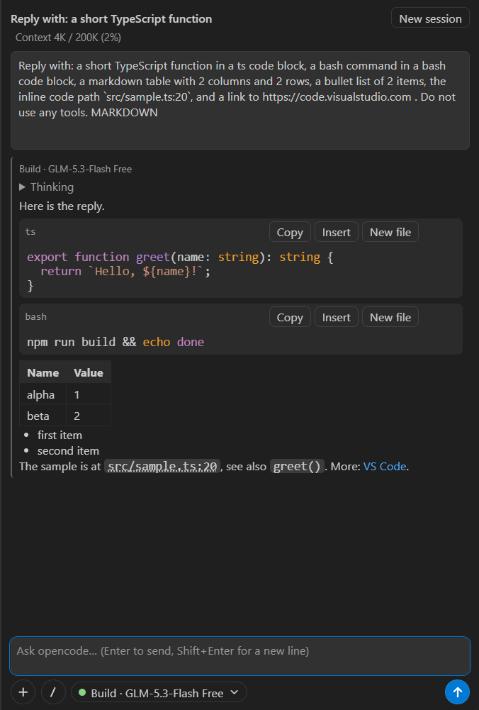
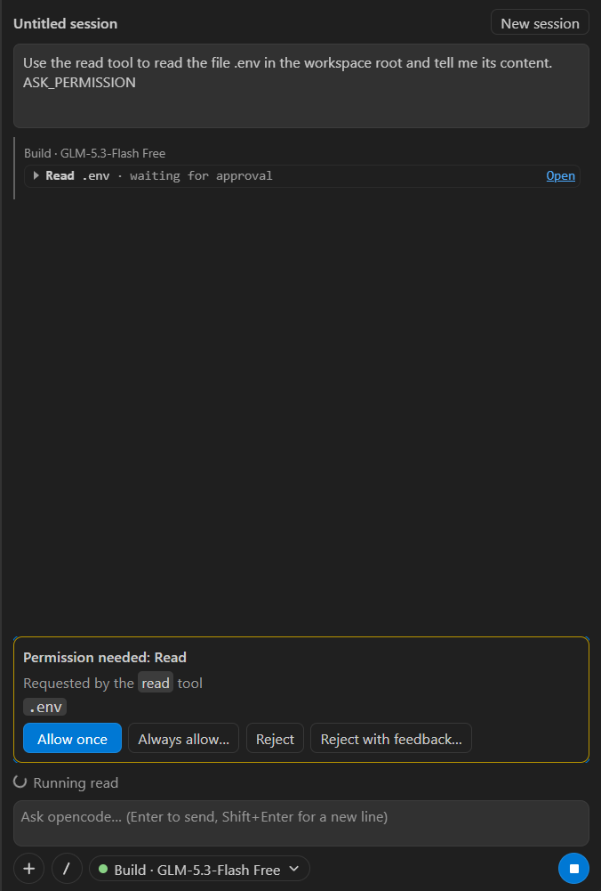
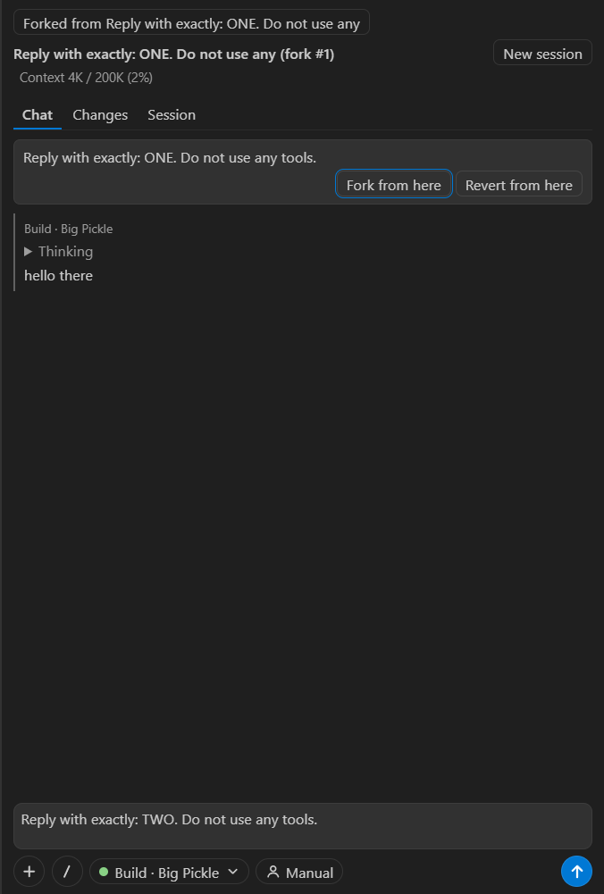
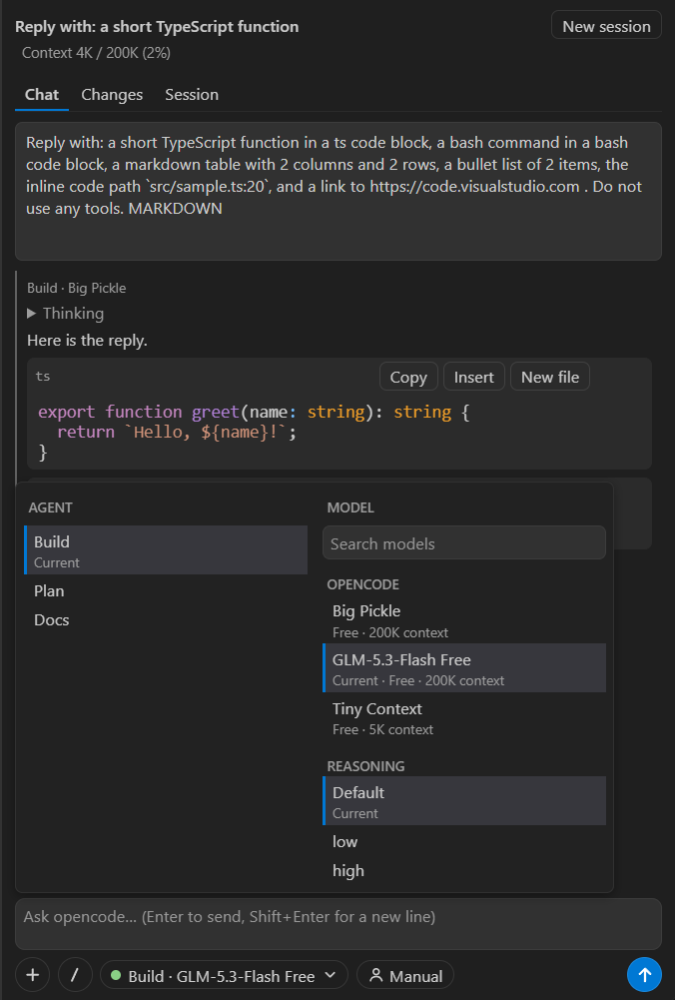

# Features and usage in detail

The [README](../README.md) ([Español](../README.es.md)) gives the short version. This page holds the
full description of what the extension does and how to use it. Commands, settings and shortcuts:
[commands.md](commands.md). What does not work yet: [limitations.md](limitations.md).

## Features

- **Streaming chat** with Markdown, syntax highlighting and code actions: copy, insert at the
  cursor, open in a new file, and open `path:line` references in the editor.

  

- **Permission and question cards.** When opencode asks, you answer with a click. With the chat
  hidden, or (with chat tabs) when the request belongs to a tab that is not in front, you get a
  notification and a badge on the Activity Bar icon. With several requests waiting they share one
  box with a tab each.

  

- **Sessions:** a list with groups and search, rename, delete, fork from any of your messages and
  jump into subagent sessions. The open session is remembered per workspace.

  

- **Organize the Sessions tree** (with `chatLocation` set to `editor`). Put sessions in **folders**
  (and folders inside folders) by dragging the rows or with **Move to Folder…**, **Pin** the ones
  you keep coming back to (they sit under **Pinned** at the top) and **Archive** the ones you are
  done with (they go to a collapsed **Archived** section, and **Unarchive** brings them back to
  their folder). A **Needs attention** section above them repeats the sessions that are running or
  waiting for your answer, so they are never buried in a folder or an archive. **Filter
  Sessions…** keeps only the running ones, the ones waiting for input or the ones open in a tab
  (**Clear Filters** removes it), and the tooltip of a row shows its cost and tokens, its folder
  and, for a session with a tab, how many files it changed. Archiving and folders only change how
  the list looks: nothing is deleted from opencode, and **Search Sessions…** still finds archived
  sessions and says so. Folders, pins and the archive are kept per workspace folder by VS Code (see
  [Known limitations](limitations.md)).

- **Quick start at the top of the container** (with `chatLocation` set to `editor`). A small box:
  type and press Enter to open a NEW tab that starts the conversation with the model you picked
  (or, if you did not pick one, that tab's usual model), with its agent and mods (Shift+Enter
  breaks the line; text only, no attachments). A status strip shows the model, the mode of the next
  conversation (Manual or Auto), any MCP server in error and, only while the server is not ready
  (starting, reconnecting, not started or down), the server; each pill is a button. The model pill
  opens a picker for the model of the next conversation: it does not change
  `openVsCode.defaultModel`, it lasts until you pick another or reload the window, and, like any
  message, the model then becomes the last one used, which new sessions propose while that setting
  is empty. The other pills open the logs or restart the server, the settings, or switch the mode;
  with the server ready, the logs are in **OpenCode: Show Logs**. **Running** lists the root
  sessions that run now with their activity, a clock and Stop (which also stops subagents running
  in the background); **Waiting for you** lists permissions and questions, and Reply opens the
  conversation with the card focused.

- **Changes and usage under the Sessions tree** (with `chatLocation` set to `editor`; both start
  collapsed the first time; VS Code then remembers what you open or close). **Changes of the
  sessions** lists the sessions that have a tab, that changed files in this window or that are in
  today's group; expand one to read its files with `+added −deleted`, and click a file to open VS
  Code's diff of it, also for a session with no tab. **Usage (all projects)** shows cost and tokens
  for today and the last 7 days by model. It counts EVERY project in your opencode database, not
  only this folder, and it asks the server nothing while it is collapsed or hidden. A model that
  reports no cost reads "cost not reported" (or "free" when the catalog says so), and the total
  then says "≥". The usage route is experimental in opencode, so a future opencode version may
  change it.

- **Server status in the status bar.** An `OpenCode` item shows whether the server is starting,
  running (with the model a new session will use), not started or unavailable; click it to open the
  chat.

- **The chat in editor tabs or in the side bar.** By default (`openVsCode.chatLocation` is
  `editor`) every session opens in its own editor tab, beside your code, and the OpenCode view is a
  native **Sessions** tree; set it to `sidebar` to keep one chat in the side bar instead. The tree
  lists the sessions of the folder grouped by Today, Yesterday, Previous 7 days and Older, each row
  with its state shown by an icon (Running, Needs input, Failed) and, when the side bar has room, in
  words (also Fork, Tab) before the time, with Rename and Delete on the row, a **Search
  Sessions…** button that searches the titles on the server, and a **Show more sessions** row.
  Clicking a session opens it in a tab, or brings that tab to the front if it already has one,
  instead of opening another. Changing the setting takes effect at once: the session of the side
  bar opens in a tab, and going back leaves the tabs open. After **Developer: Reload Window** the
  tabs come back, each with its session, its draft and its title.

- **One chip for agent and model:** the prompt bar shows "agent · model" (with the reasoning level
  and a connection dot); it opens a panel where you choose the agent (Build, Plan…), the model and,
  when the model offers them, a reasoning variant.

  

- **Slash commands (issue #33):** type `/` at the start of the prompt, or press the **/** button
  next to the "+", to list opencode's commands (the built-in `init` and `review`, the ones in your
  project's `.opencode/command` folder and the ones from MCP servers). Choosing one writes `/name`
  and a space into the box so you can add arguments; Enter runs it. A `/word` that is not on the
  list is sent as a normal prompt. The conversation shows the expanded text of the command, as
  opencode stores it, not what you typed.
- **Editor and Explorer context menus (issue #36):** right-click in a text editor for **Add to
  OpenCode Chat** (attaches the selection, or the whole file when nothing is selected), **Explain
  with OpenCode** and **Fix with OpenCode**. Explain and Fix send a ready-made prompt at once
  (`Explain what @src/a.ts#2-3 does.`, `Fix the problems in @src/a.ts#2-3.`) with the selection
  attached; Fix also lists the errors and warnings VS Code reports for that range (up to 20). In
  the Explorer, **Explain with OpenCode** works on one or several files. If the chat cannot send
  right then (a turn is running, or the server is not connected yet; with `autoStart` off and the
  server not started, the prompt is sent and starts it), the prompt is left in the prompt box with
  a notice, and your own draft is never overwritten. The entries only appear on files that exist on
  disk. From the Explorer, folders and files outside the workspace folder are counted in a notice
  inside the chat ("1 selected item was not added…"); from the editor and the Command Palette, a
  refused file (outside the workspace folder) shows a native VS Code warning. A prompt that waited
  too long for the chat to be shown (over 10 seconds) is left in the prompt box, with a notice,
  instead of being sent.
- **Collapsible tool cards** for shell, read, grep and edit calls, with diffs for edits.
- **`@` mentions** to add files to the prompt, and a "+" menu in the prompt bar with **Add
  selection** (attaches the editor selection), **Attach file…**, **Attach image…** and **Mention a
  file**.
- **Drop files and paste images (issue #30):** right-click files in the Explorer and choose **Add
  to OpenCode Chat** (works in every VS Code version), or drag them from the Explorer onto the
  prompt box **while holding Shift** (VS Code only delivers a drop to a side-bar view with Shift
  held: that is the side-bar chat, `chatLocation` set to `sidebar`; the editor tabs of the default
  location are not checked for this). Only regular files inside the workspace folder are added, and
  a dropped file must also be one that opencode lists (what git ignores, `.env` included, cannot be
  dropped: use "Attach file…" in the "+" menu for that); folders and anything else are skipped with
  one notice that counts them. Paste an image (PNG, JPEG, GIF or WebP, up to 10 MiB) with Ctrl/Cmd+V
  to attach it, with a thumbnail on its chip; an image dropped from your system's file manager is
  attached the same way, and any other file dropped from there is refused with a notice (drop it
  from the VS Code Explorer, or use "Attach file…"). If the selected model cannot read images, the
  chat says so and opencode tells the model. **Retry, "Fork from here" and "Revert from here"
  re-attach files but not pasted images**: paste them again.
- **Context and cost:** a line under the session title shows how much of the model's context the
  last step used and, when the model is not free, what the session cost so far, direct subagents
  included. From 80 % of the window the line gains a **Compact** button, which is the warning that
  the context is nearly full; the same figures, a meter and Compact are in the **Session** tab.
- **Chat, Changes and Session tabs:** a row of tabs under the header switches the central area
  between the conversation, the files the session changed, and the session's own page. The request
  cards, the subagent strip, the activity line and the prompt box stay visible in all three, so a
  permission request is never hidden. The tab you chose is kept when you hide and show the view.
  **Session** holds the pinned instructions (see below), the context meter with Compact, the token
  and cost totals, the session's subagents with Open, and **Export** (Markdown, or JSON, to a file
  you pick; the JSON holds the full text of the conversation and the file paths, so do not attach
  it to a public report).
- **Write while the agent works:** the prompt box stays open during a turn. Enter **queues** the
  message (a chip "Queued: …" appears above the box, with Steer now, Edit and a remove button; the
  server delivers it when the turn ends) and Ctrl+Enter (Cmd+Enter on macOS) **steers** the turn
  with it right away. Edit cancels the chip and gives its text back to an empty box. Stop and the
  activity line (what the agent is doing, the step number, the elapsed time and how many subagents
  run) are at the bottom of the conversation. While a turn runs, a model or agent you picked in the
  box applies from the next message sent while idle, and `/commands` of the server are refused with
  a notice until the turn ends (`/compact` is queued).
- **Pinned instructions:** the Session tab can pin short instructions to the session ("Always answer
  in Galician"); opencode sends them with every step. A value that is not plain text, pinned by
  another client, shows as JSON with a "set by another client" tag and can be removed too. They use
  opencode's experimental instructions API, so a newer opencode may change it.
- **Subagent monitor:** while a subagent works or waits, a strip above the prompt box reads
  "Subagents · N" with how many work and how many wait for your answer; open it for one row per
  subagent (agent, task, current tool, elapsed time) with Open, Answer (only when it waits on a
  permission or form), Stop and a **Stop all** that never stops the main turn. In the conversation,
  the block of each `subagent` call becomes a live card (its latest tools, Open, Stop) and folds
  into "Finished · N tools · cost", "Stopped" or "Failed: reason" when the subagent ends. It works
  in the side bar and in chat tabs.
- **Changed files:** the **Changes** tab shows "Changed files (N)", what the agent changed in the
  session (git repositories only), and its badge carries the number; a click opens VS Code's own
  diff editor with the original on the left and the file on the right.
- **Revert from a message:** "Revert from here" on one of your messages undoes that turn and
  everything after it, files included, and hides those messages. A block under the conversation
  lists the files it restored, "Restore" brings everything back and "Discard for good" deletes the
  hidden messages. Sending a new message also makes the revert final. The revert also replaces
  edits you made by hand to those files after the reverted turns touched them: "Restore" brings
  them back (but drops what you edited while reverted), and once the revert is final they are gone.
- **Themes and accessibility:** light, dark and high-contrast, keyboard navigation and screen
  reader labels. Colors come from your VS Code theme.
- **OpenCode Settings tab:** providers with connect and remove (an API key goes in a masked VS Code
  input box, OAuth signs in through your browser, or an external method), and the MCP servers with
  their status and resources, with Connect, Disconnect and Sign in until opencode restarts. It also
  holds the chat location and the automatic start of the server, the mods of the workspace (one
  switch each, Reload and Open folder), what Manual and Auto mean in Work mode (with a button that
  opens the chat), and, in Advanced, the server password, the saved permissions, the decision about
  the plugins of the folder and the shell of opencode (saved in the global opencode config, so it
  also applies to the terminal UI and every folder). Open it with the gear of the Chat and Sessions
  views, or with "OpenCode: Open Settings…".

## Usage

1. Open a folder in VS Code and click the **OpenCode** icon in the Activity Bar: the **Sessions**
   view lists the sessions of the folder. Press **New Session** in its title bar to open a chat tab
   beside your code.
2. The extension starts `opencode serve` for the workspace folder, on `127.0.0.1` with a random port
   and a random password, and stops it when the window closes.
3. Type a prompt in the tab and press Enter. Press Escape or **Stop** to interrupt a turn. From the
   editor, press Ctrl+Alt+P (Cmd+Alt+P on macOS) to jump to the prompt; press it again to come back
   to the editor (see [Keyboard shortcuts](commands.md#keyboard-shortcuts)).

To ask about code without opening the chat first, select it in the editor, right-click and choose
**Explain with OpenCode** or **Fix with OpenCode**; to send whole files, right-click them in the
Explorer and choose **Explain with OpenCode**. The chat opens by itself and the prompt is sent in
the open session.

The chat lives in editor tabs by default (`openVsCode.chatLocation` is `editor`). The OpenCode view
lists the sessions of the folder: click one (or press Enter on it) to open it, `F2` renames the
selected one and `Delete` deletes it. **New Session** opens a new tab, **Open Chat** brings the most
recent tab to the front (or opens the last session of the folder when there is none). The chat in a
tab has no Sessions button: the tree is the one place to browse sessions. Insert at cursor and Add
selection write into the last text editor you used, and file links and diffs open outside the
chat's group.

To organize the list, right-click a session: **Pin**, **Move to Folder…** and **Archive** are there
(select several rows to act on all of them, or drag them onto a folder). **New Folder…** is in the
`…` menu of the view title and in the Command Palette; right-click a folder for **New Subfolder…**,
**Rename Folder…** and **Delete Folder** (its sessions go back to the date groups, none is
deleted). The funnel button in the title bar opens **Filter Sessions…**, and **Clear Filters**
appears next to it while a filter is on. The filters live only in memory: a window reload clears
them.

To keep one chat in the side bar instead, set `openVsCode.chatLocation` to `sidebar` (Settings:
Chat Location); the OpenCode view then is the **Chat** view, and the tabs you had open stay open.

In a multi-root workspace, choose the folder opencode works in with **OpenCode: Select Workspace
Folder**.

## Languages

The extension is in English and Spanish, and follows the display language of VS Code: the command
titles, settings, notices, dialogs and both webviews. **VS Code only switches to Spanish if the
[Spanish Language Pack](https://marketplace.visualstudio.com/items?itemName=MS-CEINTL.vscode-language-pack-es)
is installed**; without it everything stays in English. To pick the language, install the pack and
run **Configure Display Language** from the Command Palette (`Ctrl+Shift+P`), choose `Español` and
restart VS Code; choose `English` to go back. The log lines in the "OpenCode" and "OpenCode Mods"
output channels are always in English, whatever the language, and so are the channel names. Adding
a language and the translation guide: [i18n.md](i18n.md).

## Building the `.vsix` from source

Node 24 and git are needed.

1. Clone the repository: `git clone https://github.com/sergwei/open-vs-code.git`
2. In the cloned folder, install the dependencies: `npm ci`
3. Build the package: `npm run vsix`. It writes `open-vs-code-<version>.vsix` in that folder.
4. In VS Code, run **Extensions: Install from VSIX...** from the Command Palette and pick that file
   (or `code --install-extension open-vs-code-<version>.vsix`).
